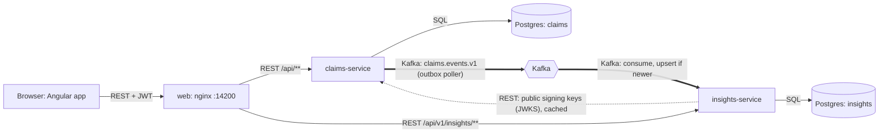

# APAC Claims Platform

A claims platform for motor and property insurance across six APAC markets (SG, HK, MY, TH, ID, AU). Claimants report claims and upload documents. Officers pick up, assess and settle them. Managers approve above an officer's limit and watch exposure, workload and performance. It is a take-home assessment: everything runs locally and the data is demo data.

## Two services, and why

| Service | Role | Owns |
|---|---|---|
| `claims-service` | Decides. Rules, lifecycle, login, documents, the reserve ledger. Must be consistent. | Postgres database `claims`, a documents volume, the JWT signing key |
| `insights-service` | Reacts. Builds a read model from events and serves exposure, workload and performance. May lag by seconds. | Postgres database `insights` |

A dashboard failure must not stop a claimant reporting a claim, so the dashboard side is a separate service that only reads events. They share no database and no code. Reasoning: [ADR 0002](docs/adr/0002-two-services.md).

## Architecture and data flow



- **REST** carries everything a person waits on: login, reporting, commands, queues, documents, and reading the dashboards.
- **Kafka** carries consequences, one way, claims to insights. A command writes its claim, ledger rows and an outbox row in one transaction; a poller publishes the outbox to `claims.events.v1`; insights applies an event only if its version is newer than what it stores. A failed event goes to `claims.events.v1.DLT`.
- The only REST call between services is insights fetching public keys to verify tokens.
- The browser polls the dashboards (15 s) and the staff queue (30 s). Dashboard responses carry `asOf`.

Related records: [outbox](docs/adr/0003-transactional-outbox.md), [event versioning](docs/adr/0004-event-snapshot-and-version.md), [compacted topic](docs/adr/0018-compacted-event-topic.md), [tokens](docs/adr/0011-local-rs256-jwt-and-jwks.md). All 18 are indexed in [docs/adr/README.md](docs/adr/README.md).

## Prerequisites

- Docker with Compose v2 (the `--wait` flag is used). About 5 GB of free memory is a safe margin: each Java service is capped at 768 MB, plus Postgres and Kafka.
- Free local ports 14200, 18080, 18081, 15432 and 19092.
- **Node is not needed to run the stack.** Docker builds the web app in `node:24-alpine`.
- **Node is needed only to run `ng test` or the dev server on your machine.** The Angular 22 CLI requires Node `^22.22.3 || ^24.15.0 || >=26.0.0` (from `web/node_modules/@angular/cli/package.json`; `web/package.json` has no `engines` field). Node 24.14.0 is too old and fails.
- Java 21 and Maven are needed only for `mvn verify` on your machine, and Docker must be running for it (Testcontainers).

## Start

```bash
docker compose up --build -d --wait
```

The first build downloads images and dependencies, so allow several minutes. `--wait` returns when every service reports healthy. Open http://127.0.0.1:14200.

If you have run an earlier build of this repository, reset its volumes first: **migrations were edited in place**, so an existing database fails Flyway's checksum check.

```bash
docker compose down -v
```

Stop and delete data with `docker compose down -v`; `docker compose down` keeps it.

### Spin up the local stack to test

Run from the repository root. This starts from empty volumes, waits until every service is healthy, then prints the URLs.

```bash
docker compose down -v
docker compose up --build -d --wait
cat <<'EOF'

Web app            http://127.0.0.1:14200
Claims API         http://127.0.0.1:18080/api/v1
Claims Swagger UI  http://127.0.0.1:18080/swagger-ui/index.html
Claims OpenAPI     http://127.0.0.1:18080/v3/api-docs
Claims health      http://127.0.0.1:18080/actuator/health
Insights API       http://127.0.0.1:18081/api/v1/insights
Insights OpenAPI   http://127.0.0.1:18081/v3/api-docs
Insights health    http://127.0.0.1:18081/actuator/health

Log in as claimant.sg@demo.test, officer.sg@demo.test or manager.sg@demo.test
Password: Password1!
EOF
```

Then test it through the browser using the [demo users](#demo-users), or run the automated checks against the running stack:

```bash
docker compose --profile test run --rm smoke        # API journey through the gateway
docker compose --profile test run --rm reconcile    # ledger, read model and API agree; run after smoke
docker compose --profile test run --rm playwright   # browser journey and accessibility
```

To stop it and delete its data:

```bash
docker compose --profile test down -v
```

### URLs and ports

Every port is bound to `127.0.0.1` only. API paths need a token from logging in, so opening `/api/v1/insights/exposure` directly returns 401. The Swagger UI and OpenAPI documents are on only because compose sets the demo profile. `insights-service` has no Swagger UI.

| What | URL or address |
|---|---|
| Web app (nginx gateway) | http://127.0.0.1:14200 |
| claims-service API | http://127.0.0.1:18080/api/v1 |
| claims-service Swagger UI | http://127.0.0.1:18080/swagger-ui/index.html |
| claims-service OpenAPI document | http://127.0.0.1:18080/v3/api-docs |
| claims-service health | http://127.0.0.1:18080/actuator/health |
| insights-service API | http://127.0.0.1:18081/api/v1/insights |
| insights-service OpenAPI document | http://127.0.0.1:18081/v3/api-docs |
| insights-service health | http://127.0.0.1:18081/actuator/health |
| Postgres | 127.0.0.1:15432 (databases `claims` and `insights`) |
| Kafka (external listener) | 127.0.0.1:19092 |

The OpenAPI documents are committed in [contracts/openapi](contracts/openapi); the event schema is in [contracts/events](contracts/events).

## Demo users

Password for all: `Password1!`. Addresses end in `@demo.test`. Seeded by `services/claims-service/src/main/resources/db/demo/V1000__demo_users_and_policies.sql`, which only the demo profile loads (the compose file sets it).

| User (before `@demo.test`) | Role | Market(s) | Approval limit |
|---|---|---|---|
| `claimant.sg`, `claimant2.sg` | Claimant | SG | |
| `claimant.hk` | Claimant | HK | |
| `claimant.my` | Claimant | MY | |
| `claimant.id` | Claimant | ID | |
| `officer.sg` | Officer | SG | 10,000 |
| `officer2.sg` | Officer (also holds policy `MOT-SG-100005`, for the conflict-of-interest case) | SG | 50,000 |
| `officer.hk` | Officer | HK | 100,000 |
| `officer.my` | Officer | MY | 20,000 |
| `officer.id` | Officer | ID | 200,000,000 |
| `manager.sg` | Manager | SG | none |
| `manager.apac` | Manager | SG, HK, MY, TH, ID, AU | none |

Limits are in each market's currency. A suggested walk-through: log in as `claimant.sg` and report a motor claim; as `officer.sg` pick it up, request information, assess it; as `manager.sg` approve it; as `officer.sg` settle it; then open Insights as `manager.sg`.

## Tests

Run from the repository root. Times were measured once on the development machine with a warm Docker and Maven cache; expect longer on a first run.

| Layer | Command | Needs | Roughly |
|---|---|---|---|
| Backend unit, integration, contract, ArchUnit | `mvn verify` | Java 21, Maven, Docker running | about 2 minutes |
| Frontend unit | `cd web && npm ci && npx ng test --watch=false` | Node as above | under 10 seconds, after install |
| Smoke through the gateway | `docker compose --profile test run --rm smoke` | stack up | under a minute |
| Reconciliation: ledger vs projection vs API, in SQL | `docker compose --profile test run --rm reconcile` | stack up, after smoke | seconds |
| Browser journey and accessibility (Playwright, axe) | `docker compose --profile test run --rm playwright` | stack up | under a minute (runs `npm ci` first) |
| Fault injection, seven scenarios | `FAULT_CLEAN=1 FAULT_BUILD=1 scripts/fault-all.sh` | Docker, host `curl` | about 6 minutes |
| API fuzzing (Schemathesis) | `docs/evidence/schemathesis/run.sh` | stack up, Docker, `python3` | about 1 minute |
| Whole path from a clean copy | `scripts/fresh-clone.sh` | Docker | 10 to 20 minutes |

Notes:

- `scripts/fault-all.sh` uses `docker-compose.fault.yml` (adds Toxiproxy) and removes volumes when `FAULT_CLEAN=1`. It writes results to `docs/evidence/faults/`. Do not run it while you are using the stack.
- `scripts/smoke.sh` and `scripts/reconcile.sh` run inside a small container (`scripts/Dockerfile.test`: Postgres client, curl, jq) so the host needs none of those tools.
- The Schemathesis script finds the compose network through the container name `chubb-claims-claims-service-1`, which depends on the fixed project name `chubb-claims` in `docker-compose.yml`.
- Mutation testing (PIT) results for the domain package are in `docs/evidence/pit`.
- Results of the full run are in [docs/REPORT.md](docs/REPORT.md).

## Placeholders and limits

- **Indicative USD rates, SLAs, authority limits and most document requirements are placeholders.** They are not company policy or market data. USD figures are labelled indicative and are never used in a decision. See [ADR 0009](docs/adr/0009-currency-per-market.md) and [ADR 0016](docs/adr/0016-market-rules-as-data.md).
- **Local credentials are for development only.** Database passwords are in `docker-compose.yml`, the demo password is public, and the demo SQL ships in the service jar (the demo profile alone decides whether it runs).
- Known gaps are listed in [docs/THREAT_MODEL.md](docs/THREAT_MODEL.md): no login rate limit, no token revocation, plaintext Kafka without ACLs, no malware scanning of uploads, no encryption at rest, the outbox table is never purged, no per-claimant limit.
- Dashboards show case reserves only: `CASE_RESERVES_EXCL_IBNR`.

## Repository map

| Path | Contents |
|---|---|
| `services/claims-service` | Spring Boot: API, domain rules (`claim/domain`), outbox, identity, documents, Flyway migrations, demo seed (`db/demo`) |
| `services/insights-service` | Spring Boot: Kafka consumer, projection, insights API |
| `web` | Angular app, nginx config (`nginx/default.conf`), Playwright tests (`e2e`) |
| `contracts` | Committed OpenAPI documents and the event JSON Schema with examples |
| `infra` | Postgres init script; Toxiproxy config for fault runs |
| `scripts` | `smoke.sh`, `reconcile.sh`, `fault-*.sh`, `fresh-clone.sh`, shared `lib.sh` |
| `docs` | ADRs, threat model, domain notes, review notes, evidence |
| `docker-compose.yml`, `docker-compose.fault.yml` | The stack; fault overlay |

## Documents

- [Architecture decision records](docs/adr/README.md)
- [Threat model](docs/THREAT_MODEL.md)
- [Claim lifecycle: the rules of record](docs/domain/LIFECYCLE.md), [glossary](docs/domain/GLOSSARY.md), [sources](docs/domain/SOURCES.md), [traceability](docs/domain/TRACEABILITY.md)
- [Review notes](docs/reviews/)
- [Evidence: faults, PIT, Schemathesis](docs/evidence/)
- [AI journal](docs/AI_JOURNAL.md): what was decided by the candidate and what was proposed by AI tooling
- [Report with test results](docs/REPORT.md)
